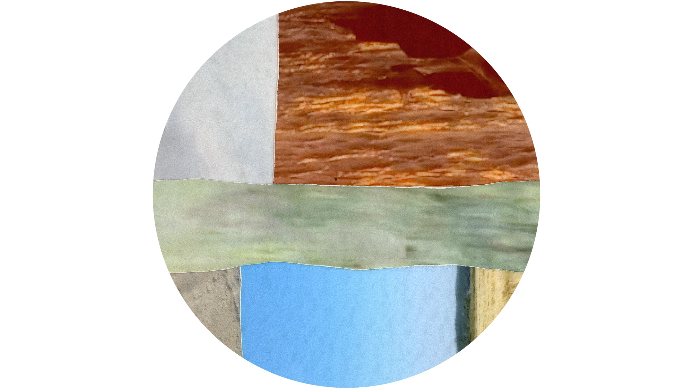

# Kamouropsie

**Fiche de construction en ligne : https://filliformes.github.io/kamouropsie/**

Œuvre présentée dans le cadre de l'exposition [An In 2026](https://www.collectifanin.com/an-in-iii-1-1) du Collectif An In, du 16 au 24 octobre 2026.

## Cartel

### *Kamouropsie*

**Vincent Fillion**  
Installation audiovisuelle générative, 2026  
Projection vidéo, conception logicielle sur mesure, transducteurs sonores.

---

La **palinopsie** (du grec *palin* « répétition » et *opsie* « vue ») est un trouble de la perception visuelle caractérisé par la persistance ou la réapparition anormale des images après la disparition du stimulus.

À l'été 2026, je me promène dans le Kamouraska où j'ai habité. Je retourne sur mes lieux de prédilection et y filme la nature avec mon téléphone. Je revois les mêmes endroits, toujours un peu différents. Je me souviens du touriste que j'ai déjà été, mon premier point de vue dans la région.

Les images restent, mais sont transformées par ma mémoire et mon biais de positivité. Comme beaucoup, je cherche souvent, sans m'en rendre compte, à enjoliver mes souvenirs. Pour les rendre tangibles, je les capture de diverses façons : photos, vidéos, enregistrements. Ces captures temporelles me semblent vraies, mais sont tout de même médiatisées par nos appareils.

*Kamouropsie* est une autopsie visuelle des moments d'extase face aux moments de doute; un retour sur les choix qu'on fait sans vraiment s'en rendre compte et qui finissent par façonner notre vie; une réflexion sur ce qu'il nous reste des paysages.

L'œuvre est entièrement créée grâce à un logiciel libre développé par l'artiste, [Palinopsia](https://github.com/filliformes/palinopsia).

## À propos de ce dépôt

L'œuvre est présentée dans la grande salle du Centre d'art de Kamouraska : un mur d'exposition qui sonne. Trois transducteurs font vibrer le gypse côté technique pendant qu'une projection circulaire occupe la face publique.

Ce dépôt contient la fiche de construction destinée à l'équipe de montage du Centre d'art.

## L'œuvre en bref

| | |
|---|---|
| Mur | 144 × 96 po, ossature 2×4 à 16 po c/c, gypse 1/2 po |
| Son | 1 bass shaker Dayton Audio BST-1 + 2 exciteurs 2 po, ampli 3 canaux 30 W |
| Image | Projecteur laser LG BU50NST, cercle Ø 96 po, lentille à 228 po du mur et à 96 po du sol |
| Lecture | Mac Mini M2 avec Palinopsia (image) et le son, sur une tablette derrière le mur |
| Signal vidéo | Ligne SDI de 45 m (3 × 15 m) entre deux convertisseurs Blackmagic HDMI ↔ SDI |
| Salle | 24'-5" × 39'-10", plafond 19'-8" |

## Contenu de la fiche

- **Vue 3D** interactive du mur, de la salle et du projecteur, avec l'emplacement de chaque pièce
- **Projection** : coupe de côté, cadre de l'image, réglages dans l'ordre, suspension, signal, points à surveiller
- **Matériel fourni par l'artiste** : ce qui arrive avec l'œuvre
- **Pièces de bois à préparer** (A à F), avec dessins cotés
- **Liste d'achats** à cocher (les cases restent cochées dans le navigateur)
- **Ordre de montage**

## Fichiers

- `index.html` : la fiche complète (page autonome)
- `projection.jpg`, `projection-small.jpg` : image d'en-tête de la fiche
- `teaser.webp` : teaser visuel de l'œuvre

La page est publiée avec GitHub Pages à partir de la branche `main`. Toute modification poussée sur `main` met le site à jour en une ou deux minutes.

## Voir en local

Ouvrir `index.html` directement dans un navigateur.
